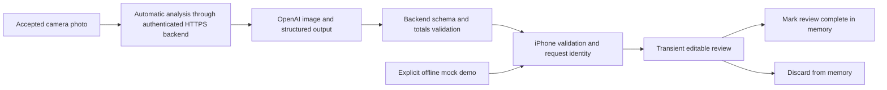

# AI food recognition: inspection and next integration

## Current owner-requested integration

Apple accepted **Loop+ 0.4.0 (4)** in [run 38278695013](https://github.com/jhardorp/LoopWorkspace/actions/runs/38278695013) and **Loop 3.14.9 (22)** in [run 38361188721](https://github.com/jhardorp/LoopWorkspace/actions/runs/38361188721). Both personal builds preconfigure the tester login. The native build starts analysis automatically after accepting the camera capture, without a separate upload confirmation. Its compact result screen places numeric labels, values and units on single lines with reduced row and section spacing; larger accessibility text sizes use stacked fields. All 46 Swift tests and app compilation passed; the standalone pipeline also passed 18 backend tests, four Ruby guards and two Python configuration tests. The native workspace passed configuration/build-order checks and compiled for the simulator; its device/Watch archive, signed export and internal TestFlight upload completed. Device installation and real camera/Keychain integration still require a phone check after Apple processing.

The owner requested credential-free personal builds, a result-first review layout and photo review inside Loop. The implementation now shares `FoodRecognitionUI` between Loop+ 0.4.0 and a pinned Loop 3.14.9 integration. Signed personal builds receive only the tester login through the temporary build plist and renew sessions using the existing Keychain connection. Provider keys remain on the server.

`Integration/LoopMealReview.patch` adds the camera/review sheet and an explicit reviewed-input method to the pinned carb-entry screen/model. Accepting copies editable values without saving or automatically advancing to bolus; the existing Continue flow handles that. The owner-requested integration uses the existing feature branch's 3.14.9 source, not a silent change to the older installed source. No submodule pointer or `main` change is needed. This reviewed build overlay replaces the earlier fork-only recommendation for this branch; a future upstream source change must rebase it and pass the full simulator build. See [integration details](../Prototypes/AIFoodRecognition/Integration/README.md).

The sections below retain the earlier standalone investigation and its historical version findings.

## Repository findings

Inspected `jhardorp/LoopWorkspace`, branch `feature/ai-food-recognition`, at `548b33245198eaae165c094c9c68fe333cb69c05`. Its default branch is `main`. The workspace is a fork of `LoopKit/LoopWorkspace` and contains 21 pinned Git submodules. Only the two submodules needed for this investigation were initialized locally; all submodule URLs/pins remain unchanged.

| Source | Pinned revision / finding |
| --- | --- |
| `Loop` | `c30b5c89b1dc4151628f33f1384dd4796eaeeec2`, upstream `LoopKit/Loop` |
| `LoopKit` | `d9f1437353482690426bd981536f58c1e95ff535`, upstream `LoopKit/LoopKit` |
| `VersionOverride.xcconfig` | **3.14.9**, build 57 at the feature branch base |
| `Loop/Loop/Views/CarbEntryView.swift` | Owns the iPhone carbohydrate-entry screen, rows, toolbar, and sheet presentation |
| `Loop/Loop/View Models/CarbEntryViewModel.swift` | Owns carb quantity/absorption input; `continueToBolus()` leads to a `BolusEntryViewModel` and recommendation generation |
| `LoopKit/LoopKitUI/CarbKit` | Reusable quantity, food-type, and absorption picker rows |
| `Loop/Loop/Extensions/DeviceDataManager+BolusEntryViewModelDelegate.swift` | Therapy-store/dosing-facing delegation; outside this prototype's scope |
| `Loop/Loop/Models/LoopConstants.swift` | Existing carb-entry upper bound 250 g; absorption input range 30 minutes–8 hours |

The requested installed version is **3.14.8**, but the existing feature branch is based on **3.14.9**. Historical workspace commit `4759818ce591ed23c03efd765c806864c9193ed3` bumps to 3.14.8 and pins Loop `2b4cd9a2feaeccf2c5c527a730d406b4d4ceb0c0` and LoopKit `421c1a256e76a7166ab2848cedba53162d34fda1`. The last 3.14.8 workspace revision immediately before the 3.14.9 bump is `df7187d8f4c57fddff0b7e56c4c2c64760b05104`, with different submodule pins. The two carb-entry source files are unchanged between the historical Loop pins examined and the current feature branch pin.

The installed app's exact 3.14.8 source revision is unknown. Before real Loop integration, identify the actual workspace/submodule revisions used for that installation and choose an isolated integration branch based on those revisions. Do not silently downgrade this existing feature branch or change the installed app.

## Fork decision

**No additional fork is required for this standalone prototype.** All new files live in `Prototypes/AIFoodRecognition` and this documentation. There are no submodule modifications or pointers to unpushed commits.

For a durable camera button in the **actual** `CarbEntryView`, use a separate **Loop fork**, with its own feature branch based on the selected compatible Loop pin. A parent workspace commit only records a submodule SHA: it cannot publish edits inside that submodule. Push the Loop changes to that fork, review them in a separate PR, then update only the integration branch's `.gitmodules` URL and Loop gitlink to the reviewed commit. Leave `main` alone.

A **LoopKit fork is not required** for the proposed camera/review UI: Loop owns that screen, and existing LoopKit rows can remain untouched. LoopKit changes would only be needed if later scope explicitly includes shared framework changes. Although this workspace supports build-time patches, a Loop fork is preferable for maintained source changes and reviewable history; this prototype adds no auto-applied patch.

## Current implementation boundary

The standalone entry preview mirrors amount, time, food type and absorption duration. AI values never populate even these preview fields. The app has no carb store, historical-data access, bolus recommendation or therapy conversion. No main-branch or submodule change is required to run it.

The owner installed the 0.1.0 mock prototype, then selected OpenAI and accepted small per-photo API charges while rejecting a new monthly subscription. The 0.2.0 source adds an authenticated Cloudflare Workers Free backend and iPhone transport. On 2026-10-12, the owner-managed credentials passed configuration checks and the separate backend was published with a verified public health endpoint. A consented device photo is still needed to verify live provider access. Offline mock fixtures are never substituted when real AI fails.

The backend uses `gpt-4.1-2025-04-14` Responses with strict JSON, `store: false`, a 35-second timeout and no retry. Only the current JPEG is submitted; no CGM, prior meals, insulin or therapy settings. A separate tester code produces a 30-minute origin-bound app token; the OpenAI key stays in server secret storage. Persistent SQLite counters default to 10 photos per UTC day and 3 per minute across sessions. Login limits use salted IP digests; counters store no images or estimates.

The app uses bounded ephemeral HTTPS without redirects, cookies, disk cache or background uploads. At the owner's request, 0.3.0 adds a prefilled public server address and one-time tester-password setup. Its device-only Keychain stores URL/tester password/short-lived session, accessible while unlocked and without iCloud synchronization; authorization renews automatically on foreground/use. The 0.2.0 address/session record migrates, but needs the password once because that older version did not store it. Logout/revocation/cancellation prevent pending renewal restoring forgotten credentials. No provider API key is stored by the app. Photos/reviews stay transient, and no photo is retried automatically. Cancel/discard/backgrounding and request identities prevent late replies restoring an abandoned review. The owner has now requested automatic analysis after capture: accepting the camera photo starts one request without a separate upload confirmation; cancelling the camera sends no image.

Estimates show foods, portion ranges, item/total carbohydrate grams, fat/protein/fiber, carbohydrate type, glycemic characteristics, absorption range/rationale, assumptions, low confidence and provenance. Nutrition is **AI inferred, not database verified**; total carbohydrate includes fiber. Duration is an **experimental composition-based suggestion**, not an individual physiological prediction or a validated Loop modeling parameter. Clarification has no numeric estimate. Invalid replies, auth/offline/timeout/quota/provider failures produce no fallback numbers.

The 0–250 g and 30–480 minute bounds are input-validation limits, not treatment recommendations. Photographs cannot establish all ingredients, quantities, preparation or physiological differences. Code tests establish neither model accuracy nor absorption validity. See [backend billing/privacy/setup](../Prototypes/AIFoodRecognition/Backend/SETUP.md), including OpenAI retention despite `store: false`.

## Remaining work before therapy-related integration

1. **Owner-controlled live setup.** Publication needs free Cloudflare account/subdomain credentials, an OpenAI project key with prepaid credits and a separate tester code in GitHub Actions secrets. The feature-only workflow transfers keys to Worker secrets; none enter the app. No billing/hosting purchase is automatic. Verify one consented photo; `/health` proves configuration only.
2. **Nutrition grounding.** Resolve recognized foods/portions against a documented nutrition source, with source identifiers and unit/recipe conversions. Check totals and carbohydrate/fiber conventions. Current inferred nutrition is labeled and cannot replace those checks.
3. **Independent evaluation.** Evaluate food/portion/carbohydrate bias, range coverage and inability-to-estimate behavior on labeled meal photos. Independently evaluate a transparent/versioned duration method with appropriate expertise. Glycemic characteristics are not an individual absorption clock; do not analyze historical CGM/meals or personalize from them, and do not make mock durations defaults.
4. **Actual Loop UI in a separate fork/PR.** Confirm installed revisions, then add the opt-in review UI to `CarbEntryView` in an isolated Loop fork. Initially permit only dismissal/discard, without access to live entry values/delegates, `continueToBolus()` or `BolusEntryViewModel`. Any later manual transfer into an entry draft requires separate explicit scope. No auto-save, insulin administration or dosing-algorithm modification is authorized here.
5. **Device verification and review.** Check unsigned CI then capture/consent/cancellation, auth/network/quota behavior, VoiceOver and large text in the separate prototype. Live model accuracy and absorption validity remain unverified. Keep the PR draft; do not merge or replace Loop.

## Validation evidence

On 2026-10-11, 28 Swift core tests passed locally with Swift 6.0.3 and container networking disabled (16 transient-review/mock tests and 12 HTTP/auth/error/cancellation tests). Seventeen Node tests passed with paid provider calls stubbed, as did JavaScript syntax and Wrangler dry-run bundling. Coverage includes current-image-only payloads, strict validation, clarification without fallback, bounds, sanitized errors/timeouts and persistent quota concurrency/window resets.

Linux has no Xcode/iOS SDK. PR CI runs the updated core and unsigned UI build on macOS plus a backend Ubuntu check without credentials or deployment. The updated tests/unsigned simulator build passed in [PR run 38175329086](https://github.com/jhardorp/LoopWorkspace/actions/runs/38175329086); separate signed 0.2.0 (2) upload passed in [run 38175789487](https://github.com/jhardorp/LoopWorkspace/actions/runs/38175789487). Apple processing/new device installation remain unverified. Camera/UI, live provider access, nutritional accuracy and absorption validity are not established by code tests. See the prototype README for manual checks.

## Separate TestFlight follow-up

The owner has a paid Apple Developer account and explicitly authorized a separate prototype TestFlight upload without a Mac. The feature branch now includes an isolated signing/upload workflow, an explicit distribution request file, a separate Fastfile, configuration guards/tests, and app-icon/archive settings. The fixed distribution identifier is `com.jhardorp.foodrecognitionprototype`. The workflow checks required secrets on the runner, uses existing encrypted signing storage without calling Loop renewal/revocation lanes, and stops before upload when the new App Store Connect app record is missing. An explicit request-file change triggers this workflow on the feature branch without merging to main. See the TestFlight guide for the required browser-only app-record and tester setup. An attempted workflow run, a signed build, an upload, and a processed TestFlight build are distinct states; none should be claimed without its corresponding result.

On 2026-10-11, [run 38158512784](https://github.com/jhardorp/LoopWorkspace/actions/runs/38158512784) passed 16 core tests, four signing-configuration guard tests, syntax checks, an unsigned simulator build, and a signed archive/export with Xcode 26.3. App Store Connect accepted the separate **Loop+** prototype upload (project version 0.1.0, build 1). The upload lane did not verify Apple processing, add testers, install the app, merge the PR, or update the installed Loop app. Physical camera, visual, and accessibility checks remain pending.

The owner later confirmed installation and provided a device screenshot of a photo in the mock review. The owner then chose OpenAI and explicitly accepted small per-photo charges while requiring no new monthly subscription. The 0.2.0 source implements that next standalone trial through a free-tier backend, but the earlier 0.1.0 run does not confirm a live backend, real provider call or 0.2.0 upload.

The subsequent authorized **Loop+ 0.2.0 (2)** build/upload succeeded in [run 38175789487](https://github.com/jhardorp/LoopWorkspace/actions/runs/38175789487). After the owner saved all four repository Actions secrets, [configuration run 38208571429](https://github.com/jhardorp/LoopWorkspace/actions/runs/38208571429) verified their presence/basic formats without displaying values. [Deployment run 38209167402](https://github.com/jhardorp/LoopWorkspace/actions/runs/38209167402) then passed the backend tests/dry run, published only the separate Worker, transferred its two secrets through stdin and verified its public health endpoint. The server address is **`https://loop-plus-meal-review.jan-1af.workers.dev`**. An independent app-style HTTPS check also returned ready. The updated device installation, live model call and food/absorption accuracy remain unverified; no paid photo analysis has been performed by this work.

The 0.3.0 remembered-login change passed 41 local Swift tests, including 13 new persistence/renewal/legacy migration/concurrency/offline/revocation/logout/server-binding checks. [Run 38271487237](https://github.com/jhardorp/LoopWorkspace/actions/runs/38271487237) also passed all 41 tests on macOS, 18 backend tests, four Ruby guards, unsigned iPhone compilation and signed export/upload. Apple accepted **0.3.0 (3)**. iPhone Keychain behavior, Apple processing, tester assignment and the device update still need owner checks. This change uses the existing backend and retains the same per-photo consent and therapy isolation. Concurrent backend runtime/observability changes were preserved; [backend run 38252740671](https://github.com/jhardorp/LoopWorkspace/actions/runs/38252740671) succeeded on retry and verified `/health` after a transient secret-upload timeout.
