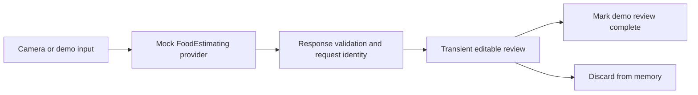

# AI food recognition: inspection and next integration

## Repository findings

Inspected `jhardorp/LoopWorkspace`, branch `feature/ai-food-recognition`, at `548b33245198eaae165c094c9c68fe333cb69c05`. Its default branch is `main`. The workspace is a fork of `LoopKit/LoopWorkspace` and contains 21 pinned Git submodules. Only the two submodules needed for this investigation were initialized locally; all submodule URLs/pins remain unchanged.

| Source | Pinned revision / finding |
| --- | --- |
| `Loop` | `c30b5c89b1dc4151628f33f1384dd4796eaeeec2`, upstream `LoopKit/Loop` |
| `LoopKit` | `d9f1437353482690426bd981536f58c1e95ff535`, upstream `LoopKit/LoopKit` |
| `VersionOverride.xcconfig` | **3.14.9**, build 57 at the feature branch base |
| `Loop/Loop/Views/CarbEntryView.swift` | Owns the iPhone carbohydrate-entry screen, rows, toolbar, and sheet presentation |
| `Loop/Loop/View Models/CarbEntryViewModel.swift` | Owns carb quantity/absorption input; `continueToBolus()` leads to a `BolusEntryViewModel` and recommendation generation |
| `LoopKit/LoopKitUI/CarbKit` | Reusable quantity, food-type, and absorption picker rows |
| `Loop/Loop/Extensions/DeviceDataManager+BolusEntryViewModelDelegate.swift` | Therapy-store/dosing-facing delegation; outside this prototype's scope |
| `Loop/Loop/Models/LoopConstants.swift` | Existing carb-entry upper bound 250 g; absorption input range 30 minutes–8 hours |

The requested installed version is **3.14.8**, but the existing feature branch is based on **3.14.9**. Historical workspace commit `4759818ce591ed23c03efd765c806864c9193ed3` bumps to 3.14.8 and pins Loop `2b4cd9a2feaeccf2c5c527a730d406b4d4ceb0c0` and LoopKit `421c1a256e76a7166ab2848cedba53162d34fda1`. The last 3.14.8 workspace revision immediately before the 3.14.9 bump is `df7187d8f4c57fddff0b7e56c4c2c64760b05104`, with different submodule pins. The two carb-entry source files are unchanged between the historical Loop pins examined and the current feature branch pin.

The installed app's exact 3.14.8 source revision is unknown. Before real Loop integration, identify the actual workspace/submodule revisions used for that installation and choose an isolated integration branch based on those revisions. Do not silently downgrade this existing feature branch or change the installed app.

## Fork decision

**No additional fork is required for this standalone prototype.** All new files live in `Prototypes/AIFoodRecognition` and this documentation. There are no submodule modifications or pointers to unpushed commits.

For a durable camera button in the **actual** `CarbEntryView`, use a separate **Loop fork**, with its own feature branch based on the selected compatible Loop pin. A parent workspace commit only records a submodule SHA: it cannot publish edits inside that submodule. Push the Loop changes to that fork, review them in a separate PR, then update only the integration branch's `.gitmodules` URL and Loop gitlink to the reviewed commit. Leave `main` alone.

A **LoopKit fork is not required** for the proposed camera/review UI: Loop owns that screen, and existing LoopKit rows can remain untouched. LoopKit changes would only be needed if later scope explicitly includes shared framework changes. Although this workspace supports build-time patches, a Loop fork is preferable for maintained source changes and reviewable history; this prototype adds no auto-applied patch.

## Current implementation boundary

The standalone entry preview mirrors the existing screen's concepts: amount consumed, time, food type, and absorption duration. Its camera launches the separate review flow. AI values never populate even the preview's manual entry fields. There is no “Continue to bolus,” carb-store dependency, historical-data access, or therapy conversion.

The estimates include food names, portions in grams with illustrative ranges, item/total carbohydrate grams, fat/protein/fiber, carbohydrate type, glycemic characteristics, a duration in **minutes**, an explanatory rationale, assumptions, confidence, and provenance. Low confidence requires acknowledgment. Unrecognizable meals produce a clarification state rather than guessed numbers. Offline/timeout fixtures are simulated; there is no network transport to validate yet.

Input limits mirror the inspected Loop UI's outer bounds for easy comparison, but are **prototype validation bounds**, not clinical recommendations or a dosing rule. The package rejects non-finite values, reversed ranges, implausible portions, empty items, invalid totals, and item totals inconsistent with the stated meal total. Duration fixtures are not a model of individual digestion. Photographs cannot reveal all ingredients, quantities, preparation, sauces, or physiological differences; duration estimates need explicit uncertainty and manual review.

## Subsequent real AI integration

1. **Backend and credentials.** Add an authenticated HTTPS backend controlled by the app owner. Keep the vision-provider API key in server-side secret storage; never put it in Swift, Info.plist, xcconfig, the app bundle, or a client-side “secret” file. Use revocable, short-lived app/session authorization in Keychain, rate limits, quotas, and abuse controls. Do not introduce a static shared backend secret into the app. Choose hosting/provider before implementing transport.
2. **Privacy and consent.** Explain image upload and destination before a real request. Upload only the current normalized meal image and explicitly supplied food/portion corrections, with no CGM, historic meals, insulin, profile, or dosing data. Define retention/deletion, provider data-use terms, regional requirements, and redact image/request contents from logs. The prototype permission string must be revised before networking is enabled because it promises no upload.
3. **Vision identification and portion uncertainty.** Select a vision-capable model and require versioned structured JSON. Return candidate foods, preparation assumptions, estimated portions/ranges, confidence, and clarification requests. Ask for a scale reference, recipe, packaging information, or user correction when the image cannot support a reliable estimate. Do not treat a precise model number as reliable merely because it is valid JSON.
4. **Nutrition grounding.** Resolve identified foods and portions against an appropriate documented nutrition source and serving-size/unit conversions. Record food-source identifiers and recipe assumptions. Check carbohydrate totals against ingredient values. Distinguish total carbohydrate from fiber conventions used by the source; don't silently subtract fiber or estimate insulin effects of protein/fat as extra carbs.
5. **Absorption duration.** Develop and independently evaluate a transparent, versioned method using composition (fat, protein, fiber), carbohydrate type, glycemic characteristics, preparation, and portion uncertainty. Return a broad supported range, rationale, and “cannot estimate” when appropriate. Glycemic index is not an individual absorption clock, and Loop's absorption-time input is a modeling parameter rather than a guaranteed digestion time. The prototype's 180/300-minute examples must not become production defaults by accident. Do not train or personalize from historical CGM/meals under this scope. Clinical expertise and validation are needed before offering durations for therapy-related decisions.
6. **iOS transport adapter.** Implement a new `FoodEstimating` provider using `URLSession` and authenticated backend calls. Reject demo inputs. Bound request/response sizes, enforce timeouts, honor task cancellation, map offline/TLS/auth/rate-limit/server/decoding errors, and validate decoded estimates before review. Bound retries; never reuse a previous meal's estimate as a fallback or queue background uploads silently. Mock and backend providers should pass the same response-boundary contract tests. There is no production endpoint or server implementation in this PR.
7. **Actual Loop UI, separately reviewed.** Add an opt-in camera button and a separately owned review session to `CarbEntryView` in the Loop fork. Present the review without access to the live `CarbEntryViewModel` or its delegate. Initially keep its only outcomes dismiss/discard, with no binding to `carbsQuantity`, `absorptionTime`, `continueToBolus()`, or `BolusEntryViewModel`. Do not touch insulin dosing code. Any later explicit “use these reviewed values” transfer to a manual entry draft is a separate scope decision requiring tests and review; never auto-save an AI estimate, trigger recommendation generation, or administer insulin.
8. **Verification.** Validate structured-schema failures, units, provider errors, auth expiration, request cancellation, duplicate taps, late responses, photo privacy, and UI accessibility. Evaluate food/portion/carbohydrate accuracy on an independent labeled meal-photo set, reporting bias, range coverage, and “unable to estimate” behavior. Evaluate absorption-duration assumptions independently; passing code tests cannot establish their physiological validity. Perform authorized simulator/device checks only after unsigned compilation and code review. The original scope authorized no merge, deployment, or installation. The owner subsequently authorized the separate standalone prototype TestFlight upload described in `Prototypes/AIFoodRecognition/TESTFLIGHT.md`; this does not authorize merging or changing the installed Loop app.

## Validation evidence

The package's 16 tests passed in Swift 6.0.3 on Linux with container network access disabled. They exercise valid fixtures, image independence, input payload bounds, decoded response validation, non-finite/reversed/out-of-bounds ranges, composition/total checks, locale decimals, editable transient review, low-confidence acknowledgment, offline/timeout recovery, clarification without numeric fallback, cancellation, and stale responses.

The local environment has no Xcode or iOS SDK. UIKit/SwiftUI compilation, camera permission behavior, actual capture, and visual/accessibility review were not locally verified. The prototype-only PR CI is configured for core tests and an unsigned simulator compile. See `Prototypes/AIFoodRecognition/README.md` for commands and manual checks; inspect CI results before approval.

## Separate TestFlight follow-up

The owner has a paid Apple Developer account and explicitly authorized a separate prototype TestFlight upload without a Mac. The feature branch now includes an isolated signing/upload workflow, an explicit distribution request file, a separate Fastfile, configuration guards/tests, and app-icon/archive settings. The fixed distribution identifier is `com.jhardorp.foodrecognitionprototype`. The workflow checks required secrets on the runner, uses existing encrypted signing storage without calling Loop renewal/revocation lanes, and stops before upload when the new App Store Connect app record is missing. An explicit request-file change triggers this workflow on the feature branch without merging to main. See the TestFlight guide for the required browser-only app-record and tester setup. An attempted workflow run, a signed build, an upload, and a processed TestFlight build are distinct states; none should be claimed without its corresponding result.

On 2026-10-11, [run 38158512784](https://github.com/jhardorp/LoopWorkspace/actions/runs/38158512784) passed 16 core tests, four signing-configuration guard tests, syntax checks, an unsigned simulator build, and a signed archive/export with Xcode 26.3. App Store Connect accepted the separate **Loop+** prototype upload (project version 0.1.0, build 1). The upload lane did not verify Apple processing, add testers, install the app, merge the PR, or update the installed Loop app. Physical camera, visual, and accessibility checks remain pending.

The owner later confirmed installation and provided a device screenshot of a photo in the mock review. The original standalone prototype milestone is therefore available on the owner's iPhone. Real AI remains a subsequent integration: the owner selected OpenAI and then required no additional monthly cost. Whether pay-per-use API charges are acceptable is unconfirmed. Do not enable paid requests or purchase hosting/billing based on that unresolved budget question.
